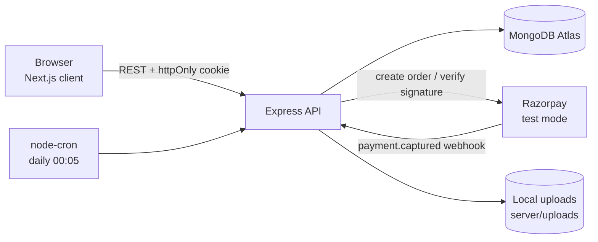
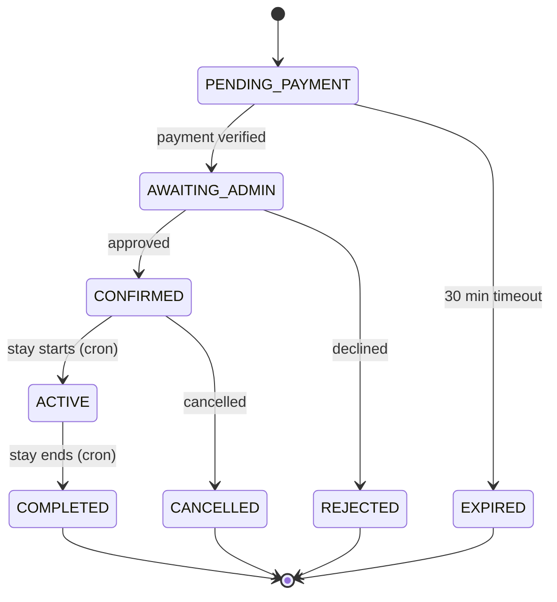

<div align="center">

# Roamly

**A full-stack vacation-rental booking platform with guest, host, and admin roles.**

Search stays, book with test-mode payments, manage listings, and cancel with transparent refunds.

<br />

[](https://roamly.gnihal.com/)


<br />

**[Live Site: roamly.gnihal.com](https://roamly.gnihal.com/)**

<br />

[Features](#features) ·
[Tech Stack](#tech-stack) ·
[Getting Started](#getting-started) ·
[Booking Lifecycle](#booking-lifecycle) ·
[Deploy](#deploy)

</div>

---

> [!WARNING]
> **Educational project.** Roamly is a portfolio/demo build inspired by common UI patterns of modern short-stay rental marketplaces. It is **not affiliated with any real marketplace**. Payments run in Razorpay **test mode**, so no real money is ever charged. Not a commercial product.

---

## Table of Contents

1. [About](#about)
2. [Features](#features)
3. [Tech Stack](#tech-stack)
4. [Architecture](#architecture)
5. [Repository Layout](#repository-layout)
6. [Getting Started](#getting-started)
7. [Environment Variables](#environment-variables)
8. [Razorpay Test Setup](#razorpay-test-setup)
9. [Booking Lifecycle](#booking-lifecycle)
10. [Cancellation Policy](#cancellation-policy)
11. [Deploy](#deploy)
12. [Troubleshooting](#troubleshooting)
13. [Security Notes](#security-notes)
14. [Disclaimers](#disclaimers)
15. [License](#license)

---

## About

Roamly is a complete rental-booking application built as a single **npm workspace**: a **Next.js (App Router)** frontend, an **Express + Mongoose** API, **MongoDB Atlas** for storage, and **Razorpay** test-mode checkout.

It covers the full booking journey: hosts publish listings, an admin approves them, guests search and pay, hosts approve bookings, a cron job moves stays through their lifecycle, and cancellations trigger automatic refunds based on a clear policy.

---

## Features

### For everyone

- Email/password authentication with **JWT in httpOnly cookies** (passwords hashed with bcryptjs)
- Three roles: **guest**, **host**, **admin**
- Search with filters for location, category, guests, price, and date range
- Persistent favourites and booking history per user

### Guests

- Search, filter, favourite, add to cart, and book
- Razorpay test-mode checkout with **server-side signature verification**
- Refund preview modal showing the exact refund amount and reason before cancelling
- Cancellation with automatic partial or full refunds (24h / 7d / 3d tiers)

### Hosts

- Create, edit, pause/resume, and delete listings, with image uploads
- Approve incoming bookings
- Per-date blocking prevents double-booking

### Admin

- Approves new home listings before they go live

### Automation

- A cron job advances bookings through `CONFIRMED → ACTIVE → COMPLETED`

### Role overview

| Capability                     | Guest | Host | Admin |
| ------------------------------ | :---: | :--: | :---: |
| Search and filter homes        |   ✅   |  ✅   |   ✅   |
| Favourite, cart, and book      |   ✅   |      |    ✅   |
| Cancel booking (with refund)   |   ✅   |      |   ✅    |
| Create / edit / pause listings |       |  ✅   |   ✅    |
| Approve incoming bookings      |       |  ✅   |  ✅     |
| Approve new listings           |       |      |   ✅   |

---

## Tech Stack

| Layer    | Tech                                  |
| -------- | ------------------------------------- |
| Frontend | Next.js 15 (App Router), React 19     |
| Backend  | Express (ESM), Mongoose               |
| Database | MongoDB Atlas                         |
| Auth     | JWT (httpOnly cookies), bcryptjs      |
| Uploads  | multer (local `server/uploads/`)      |
| Payments | Razorpay (test mode)                  |
| Cron     | node-cron                             |
| Styling  | Plain CSS in `client/app/globals.css` |

---

## Architecture



**How a booking flows**

1. A guest picks dates and checks out. The API creates a Razorpay order and a `PENDING_PAYMENT` booking.
2. After payment, the server verifies the Razorpay signature and moves the booking to `AWAITING_ADMIN`.
3. The host approves it and the booking becomes `CONFIRMED`, locking those dates for the home.
4. The daily cron moves it to `ACTIVE` when the stay starts and `COMPLETED` when it ends.

---

## Repository Layout

```text
roamly/
├── client/                 # Next.js frontend
│   ├── app/                # App Router pages
│   ├── components/         # Shared UI components
│   ├── providers/          # React context providers
│   ├── public/             # Static assets (logo, favicon)
│   └── next.config.js
├── server/                 # Express API
│   ├── src/
│   │   ├── config/         # DB, env, Razorpay setup
│   │   ├── controllers/    # Route handlers
│   │   ├── middleware/     # Auth, uploads, error handler
│   │   ├── models/         # Mongoose schemas
│   │   ├── routes/         # Express routers
│   │   ├── jobs/           # Cron jobs
│   │   ├── utils/          # Helpers
│   │   └── scripts/        # Seed script
│   └── uploads/            # Dev-only file storage
├── docs/                   # Architecture notes (optional)
├── .env                    # Server env (gitignored)
├── .env.example            # Template
├── package.json            # npm workspaces root
├── LICENSE
└── README.md
```

---

## Getting Started

### 1. Prerequisites

- **Node.js 20+**
- A **MongoDB Atlas** cluster (the free tier is fine)
- A **Razorpay** test account (only needed for the payment flow)

### 2. Clone and install

```bash
git clone https://github.com/nihal705/roamly.git
cd roamly
npm install
```

### 3. Configure environment files

**Root `.env`**: server secrets

```env
NODE_ENV=development
PORT=5000

MONGODB_URI=mongodb+srv://<user>:<pass>@<cluster>.mongodb.net/roamly
JWT_SECRET=<48-char-random-string>
CLIENT_URL=http://localhost:3000

RAZORPAY_KEY_ID=rzp_test_xxxxxxxxxxxx
RAZORPAY_KEY_SECRET=xxxxxxxxxxxxxxxxxxxxxxxx
RAZORPAY_WEBHOOK_SECRET=whsec_xxxxxxxxxxxxxxxx
```

Generate a strong `JWT_SECRET`:

```bash
node -e "console.log(require('crypto').randomBytes(48).toString('hex'))"
```

**`client/.env.local`**: browser-safe variables only

```env
NEXT_PUBLIC_API_URL=http://localhost:5000/api
NEXT_PUBLIC_RAZORPAY_KEY_ID=rzp_test_xxxxxxxxxxxx
```

> [!CAUTION]
> Never put `RAZORPAY_KEY_SECRET` or `JWT_SECRET` in `client/.env.local`. Anything prefixed with `NEXT_PUBLIC_` is exposed to the browser.

### 4. Start the dev servers

```bash
npm run dev
```

| Service      | URL                              |
| ------------ | -------------------------------- |
| Frontend     | http://localhost:3000            |
| API          | http://localhost:5000            |
| Health check | http://localhost:5000/api/health |

---

## Environment Variables

### Server (root `.env`)

| Variable                  | Required | Description                                       |
| ------------------------- | :------: | ------------------------------------------------- |
| `NODE_ENV`                |    ✅     | `development` or `production`                     |
| `PORT`                    |    ✅     | API port (Render sets this automatically)         |
| `MONGODB_URI`             |    ✅     | MongoDB Atlas connection string                   |
| `JWT_SECRET`              |    ✅     | Long random string used to sign auth tokens       |
| `CLIENT_URL`              |    ✅     | Frontend origin, used for CORS and cookies        |
| `RAZORPAY_KEY_ID`         | Payments | Razorpay test Key ID                              |
| `RAZORPAY_KEY_SECRET`     | Payments | Razorpay test Key Secret (server only)            |
| `RAZORPAY_WEBHOOK_SECRET` | Payments | Signing secret for the `payment.captured` webhook |

### Client (`client/.env.local`)

| Variable                      | Required | Description                           |
| ----------------------------- | :------: | ------------------------------------- |
| `NEXT_PUBLIC_API_URL`         |    ✅     | Base URL of the API, ending in `/api` |
| `NEXT_PUBLIC_RAZORPAY_KEY_ID` | Payments | Razorpay test Key ID (public)         |

---

## Razorpay Test Setup

1. Sign up at [razorpay.com](https://razorpay.com) and switch to **Test Mode**.
2. Go to **Account & Settings → API Keys → Generate Test Key**.
   - Key ID → `NEXT_PUBLIC_RAZORPAY_KEY_ID` (client) and `RAZORPAY_KEY_ID` (server)
   - Key Secret → `RAZORPAY_KEY_SECRET` (server only)
3. Go to **Webhooks → Add New Webhook**.
   - URL: `https://<your-api>/api/payments/webhook`
   - Event: `payment.captured`
   - Copy the signing secret into `RAZORPAY_WEBHOOK_SECRET`

**Test card details**

| Field  | Value                 |
| ------ | --------------------- |
| Card   | `4111 1111 1111 1111` |
| Expiry | Any future date       |
| CVV    | Any 3 digits          |
| OTP    | `1234`                |

> [!TIP]
> If Razorpay keys are missing, the server returns `demo: true` and the cart page auto-confirms the booking. This is useful for trying the app before wiring real credentials.

---

## Booking Lifecycle



| Status            | Meaning                                           |
| ----------------- | ------------------------------------------------- |
| `PENDING_PAYMENT` | Razorpay order created, awaiting payment          |
| `AWAITING_ADMIN`  | Paid, awaiting host approval                      |
| `CONFIRMED`       | Host approved; dates are locked for this home     |
| `ACTIVE`          | Stay in progress (cron at 00:05 daily)            |
| `COMPLETED`       | Stay ended (cron at 00:05 daily)                  |
| `REJECTED`        | Terminal: booking declined                        |
| `CANCELLED`       | Terminal: booking cancelled                       |
| `EXPIRED`         | Terminal: payment not completed within 30 minutes |

A home is only hidden from search when the host **manually pauses** it. Individual bookings block only their own date ranges through conflict detection.

---

## Cancellation Policy

| Condition                                                   | Refund |
| ----------------------------------------------------------- | :----: |
| Cancel within 24h of booking **and** check-in > 2 days away |  100%  |
| 7+ days before check-in                                     |  100%  |
| 3–6 days before check-in                                    |   50%  |
| 0–2 days before check-in, or after check-in                 |   0%   |

The user sees the exact refund amount and reason in a modal before confirming.

---

## Deploy

### Frontend → Vercel

1. Import the repo and set the **root directory** to `client/`.
2. Add environment variables:
   - `NEXT_PUBLIC_API_URL` = your Render URL + `/api`
   - `NEXT_PUBLIC_RAZORPAY_KEY_ID` = Razorpay test key
3. Deploy.

### Backend → Render

1. Create a **Web Service** pointing to `server/`.
2. Build command: `npm install`
3. Start command: `node src/server.js`
4. Add environment variables:
   - `NODE_ENV=production`
   - `PORT` (Render sets this automatically)
   - `MONGODB_URI`
   - `JWT_SECRET`
   - `CLIENT_URL` = your Vercel URL
   - `RAZORPAY_KEY_ID`, `RAZORPAY_KEY_SECRET`, `RAZORPAY_WEBHOOK_SECRET`
5. Deploy.

### After both are live

- [ ] Update the Razorpay webhook URL to `https://<render-url>/api/payments/webhook`.
- [ ] Verify login works end to end (cookie domain and CORS rely on `CLIENT_URL`).
- [ ] Confirm uploads are served. Render's ephemeral storage resets on every redeploy, so migrate to Cloudinary or S3 for production use.

---

## Troubleshooting

| Problem                         | Likely cause and fix                                                                                      |
| ------------------------------- | --------------------------------------------------------------------------------------------------------- |
| Login works locally, fails live | `CLIENT_URL` on the server must exactly match the deployed frontend URL (cookies and CORS depend on it).  |
| Payment screen auto-confirms    | Razorpay keys are missing, so the app is running in demo mode. Add test keys to enable real checkout.     |
| Webhook never fires             | Check the webhook URL, that the `payment.captured` event is selected, and that the secret matches.        |
| Uploaded images disappear       | Render's disk is ephemeral. Move uploads to Cloudinary or S3.                                             |
| Cannot connect to MongoDB       | Confirm `MONGODB_URI` and that your IP address is allowed in Atlas Network Access.                        |
| API calls fail from the browser | `NEXT_PUBLIC_API_URL` must end in `/api` and point to the running server.                                |

---

## Security Notes

- Auth tokens live in **httpOnly cookies**, so client-side JavaScript cannot read them.
- Passwords are hashed with **bcryptjs** and never stored in plain text.
- Razorpay payments are verified with a **server-side signature check**.
- Secrets (`JWT_SECRET`, `RAZORPAY_KEY_SECRET`, `RAZORPAY_WEBHOOK_SECRET`) stay on the server and the root `.env` is gitignored.
- Use a throwaway password on any public demo. Accounts may be deleted at any time.

---

## Disclaimers

- Not affiliated with any real marketplace or booking platform. The visual style is inspired by common industry patterns; no proprietary assets are used.
- Payments are simulated via Razorpay test mode. **Never enter real card details.**
- Use a throwaway password. Any account on the demo may be deleted at any time.
- See `/terms` in the running app for the full text.

---

## License

Released under the **MIT License**. See [LICENSE](./LICENSE) for details. The visual style is inspired by common industry patterns and does not copy any proprietary assets.

---

<div align="center">

If you found this project useful, consider giving it a ⭐

</div>